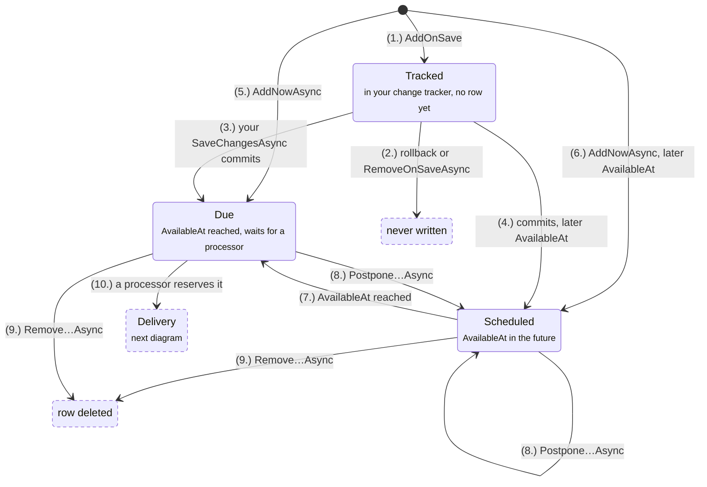
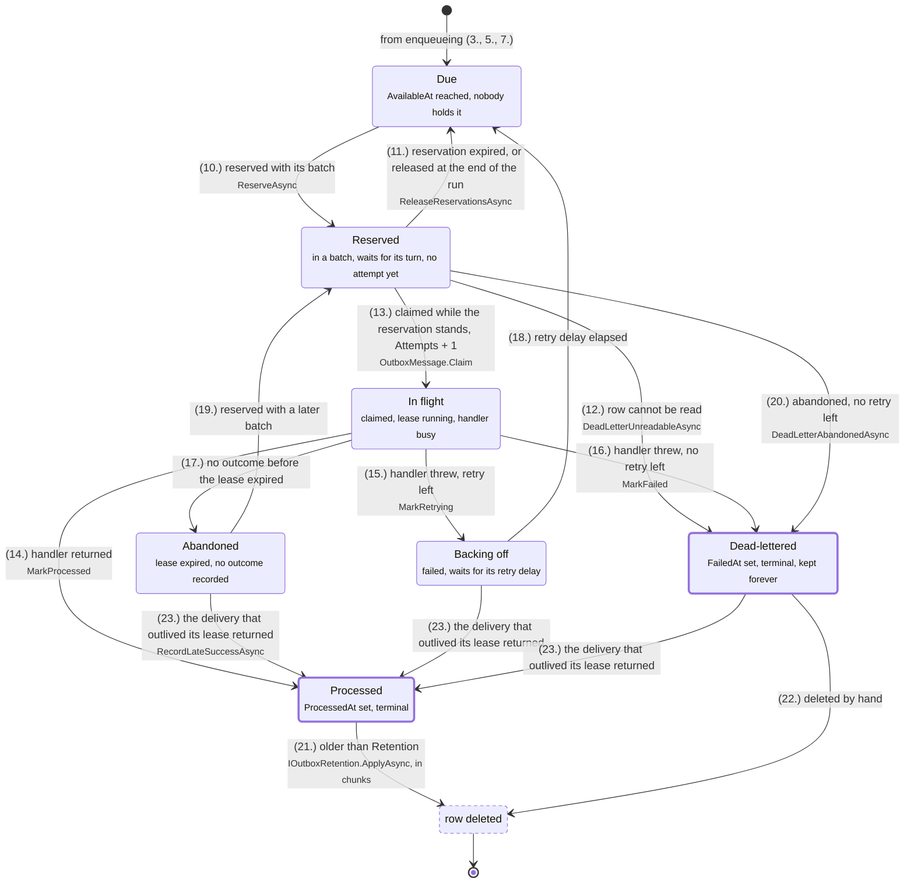
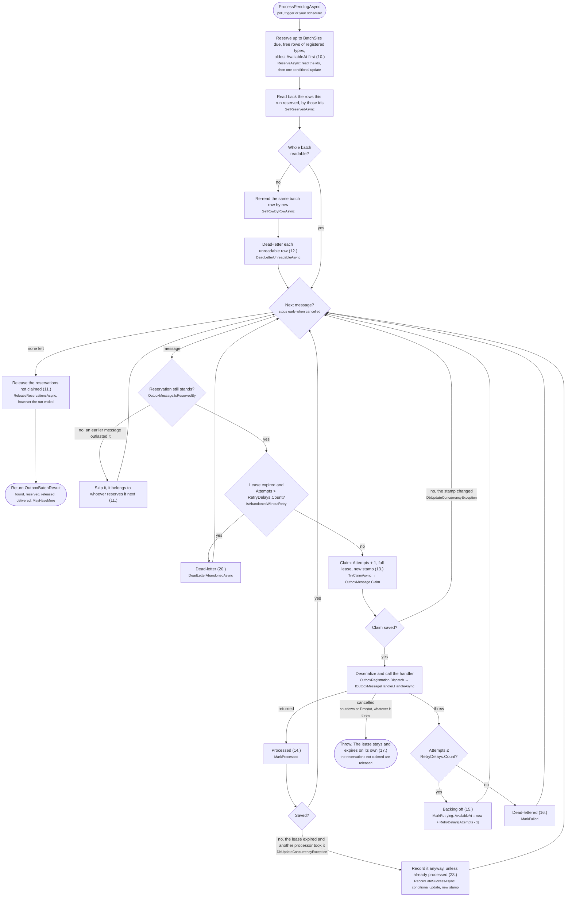

# Outbox message lifecycle

A map of the states an outbox message goes through. For setup and the API, see [Transactional Outbox](README.md#transactional-outbox).

A message is one row of [`OutboxMessage`](Outbox/Models/OutboxMessage.cs).

## The states

### 1. Getting into the queue

[`IOutbox<TDbContext>`](Outbox/Outbox%7BTDbContext%7D.cs):

### 2. Delivery

[`OutboxProcessor<TDbContext>`](Outbox/OutboxProcessor%7BTDbContext%7D.cs)

A reference to a message is called a *ticket* (id + concurrency stamp). Once a processor claims the message, its tickets become stale (new concurrency token).

## State legend

| State | The row | Where to look |
|---|---|---|
| **Tracked** | No row yet, only an `Added` entry in your context | `Outbox.AddOnSave` |
| **Scheduled** | `AvailableAt` > now | `OutboxMessageSettings.AvailableAt`, `Outbox.Postpone…Async` |
| **Due** | `AvailableAt` ≤ now, neither reserved nor claimed | `OutboxMessage.IsDueAndFree` |
| **Reserved** | `ClaimedBy` set, `ReservedUntil` > now | `OutboxProcessor.ReserveAsync`, `OutboxOptions.ReservationDuration` |
| **In flight** | Claimed, `ClaimedUntil` > now | `OutboxMessage.Claim`, `OutboxOptions.LeaseDuration` |
| **Backing off** | `AvailableAt` > now, `LastError` set | `OutboxMessage.MarkRetrying`, `OutboxOptions.RetryDelays` |
| **Abandoned** | Claimed, `ClaimedUntil` < now | `OutboxMessage.IsAbandonedWithoutRetry` |
| **Processed** | `ProcessedAt` set | `OutboxMessage.MarkProcessed`, `OutboxRetentionOptions.Retention` |
| **Dead-lettered** | `FailedAt` set | `OutboxMessage.MarkFailed`, [below](#dead-letters) |

## One processor run

`ProcessPendingAsync` handles one batch per call. `OutboxDispatchRecurringTask` calls it again while `OutboxBatchResult.MayHaveMore`, so one iteration drains a backlog. The numbers in brackets refer to the transitions above.

Two checks prevent a double delivery. The update that reserves the batch repeats the "due and free" filter, and the database checks it again on each row it locks. A row another processor reserved, claimed or postponed after the ids were read is skipped. Without that check, the read-back would pick up the stamp of the other processor's claim, and this run's claim would succeed as well. The claim is saved against the concurrency stamp, so of two processors holding the same stamp, only one claims.

A handler that runs past `LeaseDuration` can be delivered twice: the message is taken again once the lease expires. When the slow delivery returns, its success is recorded anyway (23.), over a retry or a dead letter recorded in the meantime. Only an earlier recorded delivery is kept.
