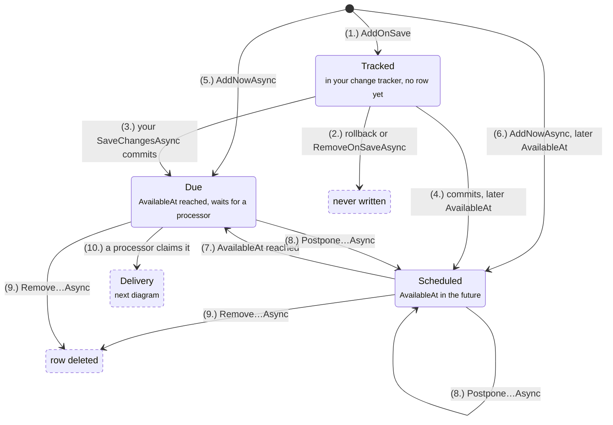
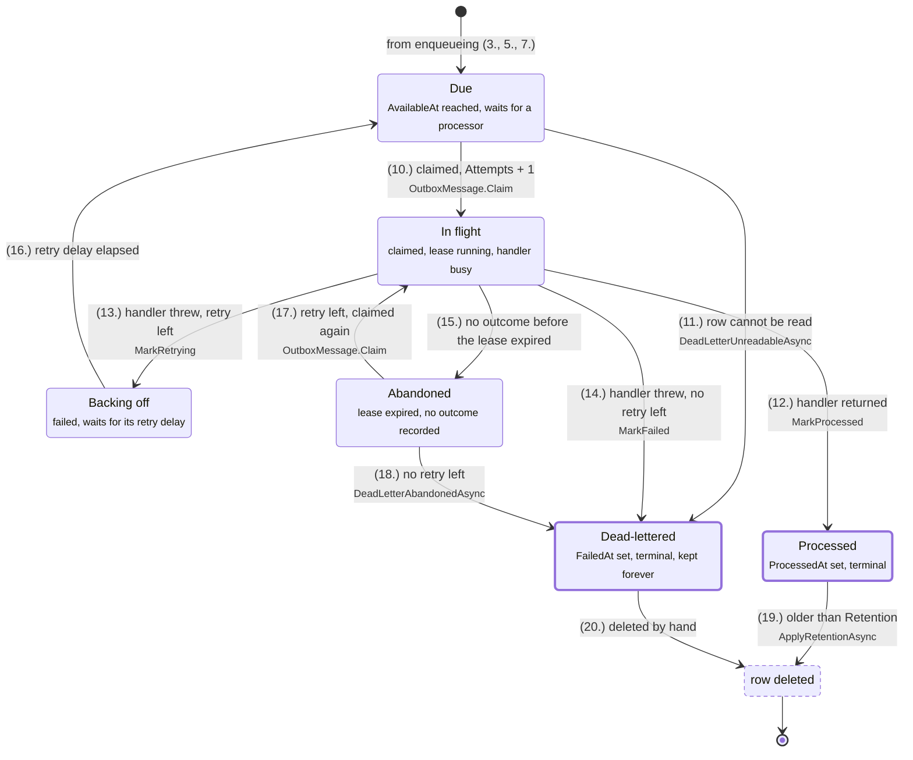
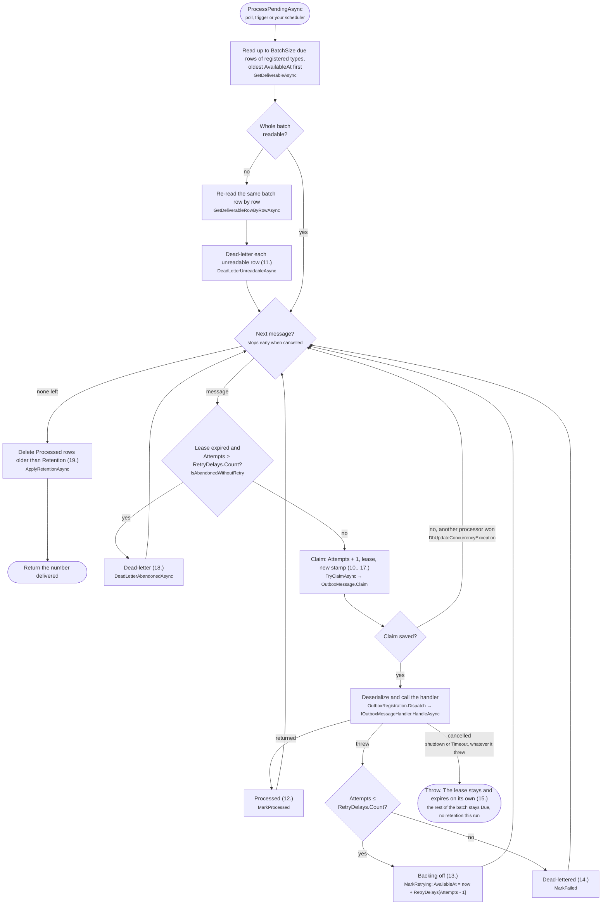

# Outbox message lifecycle

A map of the states an outbox message goes through. For setup and the API, see [Transactional Outbox](README.md#transactional-outbox).

A message is one row of [`OutboxMessage`](Outbox/Models/OutboxMessage.cs).

## The states

### 1. Getting into the queue

[`IOutbox<TDbContext>`](Outbox/Outbox%7BTDbContext%7D.cs):

### 2. Delivery

[`OutboxProcessor<TDbContext>`](Outbox/OutboxProcessor%7BTDbContext%7D.cs)

A reference to a message is called a *ticket* (id + concurrency stamp). Once anything claims a message, the messages' tickets become stale.

## State legend

| State | The row | Where to look |
|---|---|---|
| **Tracked** | No row yet, only an `Added` entry in your context | `Outbox.AddOnSave` |
| **Scheduled** | `AvailableAt` > now | `OutboxMessageSettings.AvailableAt`, `Outbox.Postpone…Async` |
| **Due** | `AvailableAt` ≤ now, unclaimed | `OutboxProcessor.CreateDeliverableMessagesQuery` |
| **In flight** | Claimed, `ClaimedUntil` > now | `OutboxMessage.Claim` |
| **Backing off** | `AvailableAt` > now, `LastError` set | `OutboxMessage.MarkRetrying`, `OutboxOptions.RetryDelays` |
| **Abandoned** | Claimed, `ClaimedUntil` < now | `OutboxMessage.IsAbandonedWithoutRetry` |
| **Processed** | `ProcessedAt` set | `OutboxMessage.MarkProcessed`, `OutboxOptions.Retention` |
| **Dead-lettered** | `FailedAt` set | `OutboxMessage.MarkFailed`, [below](#dead-letters) |

## One processor run

`ProcessPendingAsync` handles one batch per call. The numbers in brackets refer to the transitions above.

